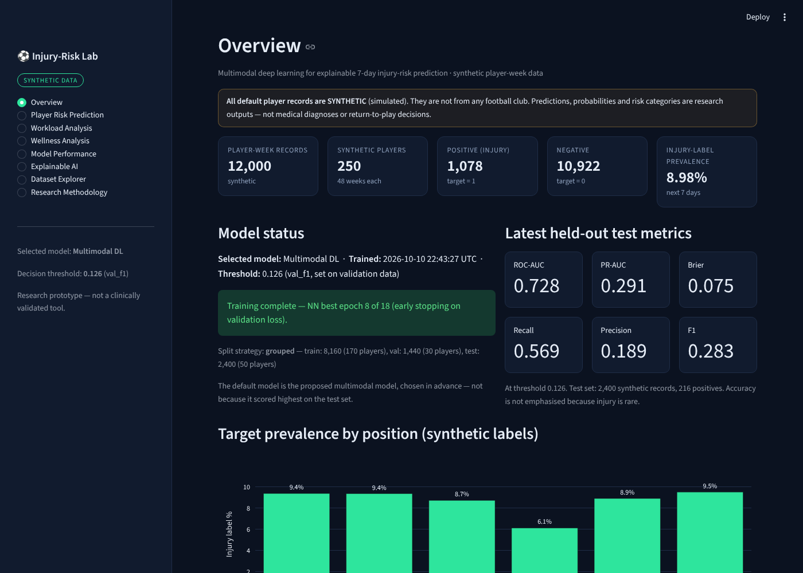
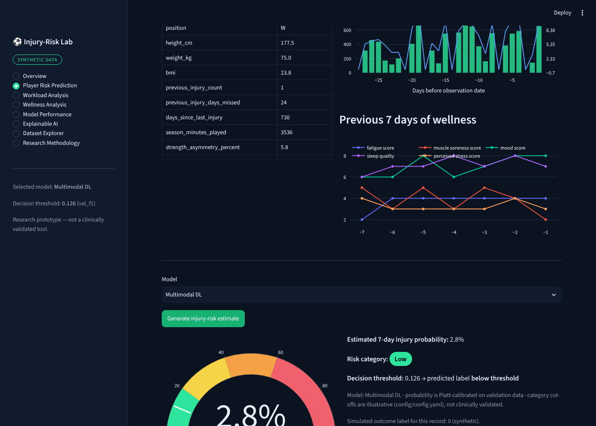
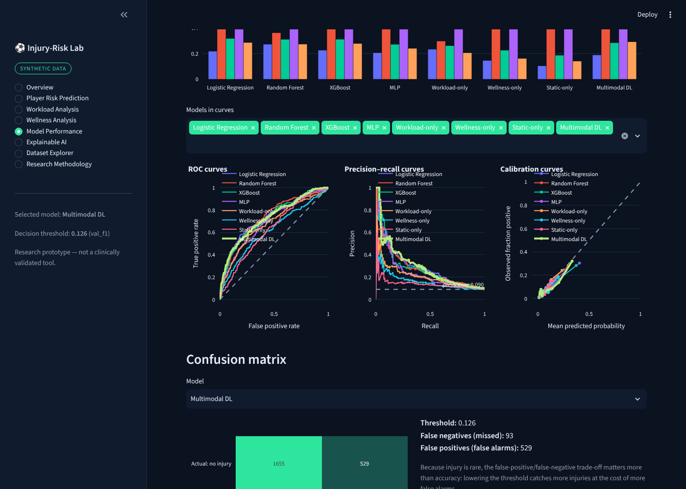
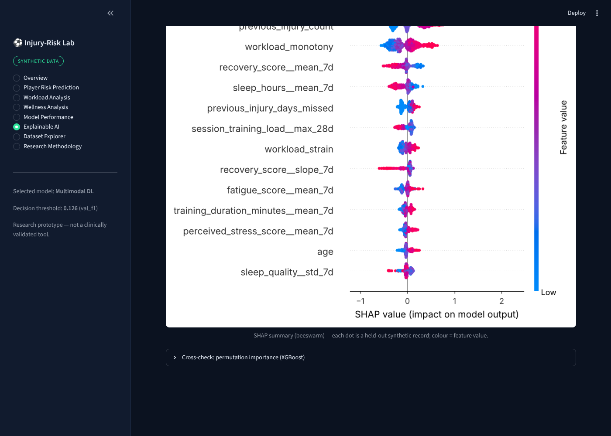

# Multimodal Deep Learning for Explainable Injury-Risk Prediction in Football

> **Research prototype on SYNTHETIC data.** Every player record here is simulated; none comes from a real club.
> Outputs are research results, not medical diagnoses or return-to-play decisions. This implementation's numbers are **not** the IEEE paper's reported results.

## Abstract
A PyTorch multimodal network predicts whether a player will sustain a time-loss injury in the **next 7 days** by fusing three modalities - static/medical features, a 28-day workload series and a 7-day wellness series - through separate encoders and a concatenation-fusion head. The project covers a reproducible synthetic data generator (12,000 player-weeks, 8.98 % positives), leakage-safe preprocessing, seven baselines, calibrated probabilities, validation-selected thresholds, SHAP / Integrated Gradients / permutation explainability, a Streamlit dashboard, downloadable reports, 48 automated tests and full documentation.

## Problem statement and objectives
Injury is rare and multi-factorial. Objectives: (1) simulate a plausible monitoring dataset; (2) build and compare a multimodal deep model against classical and unimodal baselines under one evaluation protocol; (3) provide explanations at feature and modality level; (4) deliver everything as an inspectable, reproducible application.

## Dataset (SYNTHETIC)
`python -m src.data.generate_dataset` creates `data/processed/football_injury_dataset.csv`: **12,000 records**, 250 players x 48 weekly assessments, **1,078 positives (8.98 %)**. The exact positive count (round(0.0898 x 12,000)) is a documented choice. Labels come from a probabilistic mechanism using observable features plus a hidden player trait and noise; hidden values are never saved. No public supplementary dataset is used. Data dictionary: `docs/data_dictionary.md`; quality report: `results/metrics/data_quality_report.md` (17 checks, all pass).

| Modality | Content |
|---|---|
| Static & medical | age, position, height, weight, BMI, previous injuries, days missed, days since last injury, minutes, strength asymmetry, average rest days |
| Workload | 28 days x 8 channels (distance, high-speed, sprint, accelerations, decelerations, duration, RPE, session load) + 7 derived features (acute, chronic, ACWR, monotony, strain, variability, change) |
| Wellness | 7 days x 7 scores (sleep hours/quality, fatigue, soreness, mood, recovery, stress), directions documented |

## Architecture
Static MLP encoder + GRU/attention workload encoder + GRU/attention wellness encoder -> concatenate -> fusion MLP -> logit. See `docs/architecture.md` (Mermaid diagram). Sizes are implementation choices.

## Training and evaluation
Preprocessing is fit on train only; the default split is **player-grouped** (170 / 30 / 50 players = **8,160 / 1,440 / 2,400** records, no player overlap). Positive weight (neg/pos)^0.5 for all models; AdamW + BCE-with-logits + early stopping (best epoch 8, stopped at 18). Platt calibration and the decision threshold (max-F1) are fit on validation data only; the test set is used once. Details: `docs/methodology.md`.

### Results (held-out synthetic test set, 2,400 records, 216 positives)
| Model | Precision | Recall | F1 | ROC-AUC | PR-AUC | Brier |
|---|---|---|---|---|---|---|
| Logistic Regression | 0.217 | 0.583 | 0.317 | 0.734 | 0.286 | 0.075 |
| Random Forest | 0.272 | 0.361 | 0.310 | 0.739 | 0.273 | 0.075 |
| XGBoost | 0.225 | 0.500 | 0.311 | 0.727 | 0.277 | 0.076 |
| MLP | 0.206 | 0.398 | 0.271 | 0.695 | 0.240 | 0.077 |
| Workload-only | 0.233 | 0.296 | 0.261 | 0.678 | 0.205 | 0.078 |
| Wellness-only | 0.145 | 0.500 | 0.225 | 0.618 | 0.162 | 0.080 |
| Static-only | 0.104 | 0.894 | 0.186 | 0.625 | 0.141 | 0.081 |
| **Multimodal DL** | 0.189 | 0.569 | 0.283 | 0.728 | **0.291** | 0.075 |

Honest reading: the multimodal network has the highest PR-AUC and clearly beats every single-modality model, but it is **not** clearly better than logistic regression, random forest or XGBoost (differences are within sampling noise with 216 positives). Single-seed run; values are produced by `src.training.train` and saved in `results/metrics/model_comparison.csv`.

## Explainable AI
SHAP TreeExplainer (XGBoost), Integrated Gradients (neural network, completeness error 0.008), permutation importance and SHAP GradientExplainer. Methods **disagree** on modality shares (IG: static largest; permutation drop: workload largest) - see `results/explainability/`. Explanations describe model behaviour on synthetic data, not causes of injury.

## Installation (macOS)
```bash
python3 -m venv .venv && source .venv/bin/activate
pip install -r requirements.txt
```
Runs on a Mac CPU; no GPU, paid API, cloud service or database needed.

## First-run workflow (exact commands)
```bash
python -m src.data.generate_dataset          # 1. synthetic dataset (SYNTHETIC)
python -m src.data.validation                # 2. data-quality report
python -m src.training.train                 # 3. train all models + metrics + figures (~1 min on CPU); add --smoke for a quick test
python -m src.explainability.shap_explainer  # 4. SHAP / IG / permutation artifacts
streamlit run app.py                         # 5. dashboard
pytest                                       # tests (48)
```
Options: `--split-strategy random_stratified`, `--threshold-strategy fixed|val_f1|val_youden|val_recall_target`, `--seed N`. Settings (risk categories, sizes, learning rate...) live in `config/config.yaml`.


## Paper-faithful pipeline and real-data path (`src/paper`)
The IEEE-paper architecture (per-modality MLP encoders -> 16-d embeddings -> logistic-regression fusion head, 7 baselines, Youden threshold, bootstrap CIs, permutation Shapley) is in `src/paper/`; the PyTorch GRU model above is an **extension**, not the paper's model.
```bash
python -m src.paper.run generate      # SYNTHETIC tables + player-weeks
python -m src.paper.run train         # train + evaluate (results/paper/)
python -m src.paper.run explain       # Shapley
python -m src.paper.export_web        # JSON for the website (results/web/)
python -m src.paper.run real --mapping config/real_data_mapping.yaml   # real data: zero-shot / fine-tune / retrain
```
Results and an honest comparison with the paper: `docs/paper_replication.md`. Real-data guide: `docs/real_data_guide.md`. The Streamlit app still serves the GRU variant.

## Dashboard
Pages: Overview, Player Risk Prediction (dataset or hypothetical player, CSV/PDF report), Workload, Wellness, Model Performance, Explainable AI, Dataset Explorer, Research Methodology.

### Screenshots





## Directory structure
```
app.py  config/config.yaml  requirements.txt
src/{data,features,models,training,evaluation,explainability,utils}  src/inference.py  src/reporting.py
tests/  docs/  notebooks/  data/{raw,processed,sample}  models/  results/{figures,metrics,predictions,explainability}
```
(Large regenerable artifacts - the CSV and model files - are git-ignored; recreate with the commands above.)

## Limitations
Synthetic data only; associations are not causal; few positives; one cohort and one seed; illustrative risk cut-offs; no clinical validation. See `docs/limitations.md`.

## Future scope
Real, ethically approved monitoring data with external validation; multiple seeds and confidence intervals; hyper-parameter search on validation data; temporal (forward-chaining) splits; survival/time-to-event modelling; uncertainty estimation.
