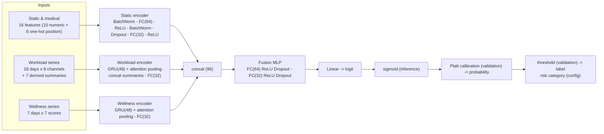

# Architecture

All sizes are **implementation choices** (the paper does not specify them); see `config/config.yaml`.

## Data flow
1. **Static encoder** - standardised numeric static/medical features and one-hot position pass through input BatchNorm, a hidden layer, and a 32-d embedding.
2. **Workload encoder** - the 28 x 8 standardised daily sequence is read by a GRU (LSTM selectable); attention pooling weights the 28 hidden states, the 7 standardised derived summaries (acute, chronic, ACWR, monotony, strain, variability, change) are concatenated, and a linear layer gives a 32-d embedding.
3. **Wellness encoder** - the 7 x 7 sequence goes through a GRU with attention pooling to a 32-d embedding.
4. **Fusion** - `combined = concat(static, workload, wellness)` (96-d) -> two FC+ReLU+Dropout blocks -> one logit.
5. **Training** uses `BCEWithLogitsLoss(pos_weight)` on raw logits, AdamW, early stopping on validation loss and best-checkpoint restore. **Inference** applies sigmoid, then a Platt calibrator fitted on validation data.
6. `MultimodalInjuryNet.freeze(...)` can freeze an encoder: its parameters get no gradient and its BatchNorm/Dropout stay in eval mode (tested).

## Software layout
`generate_dataset -> validation -> preprocessing (train-only fit) -> baselines + nn_trainer -> metrics/plots -> shap_explainer -> inference -> app.py`
